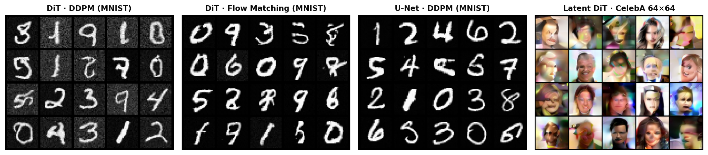
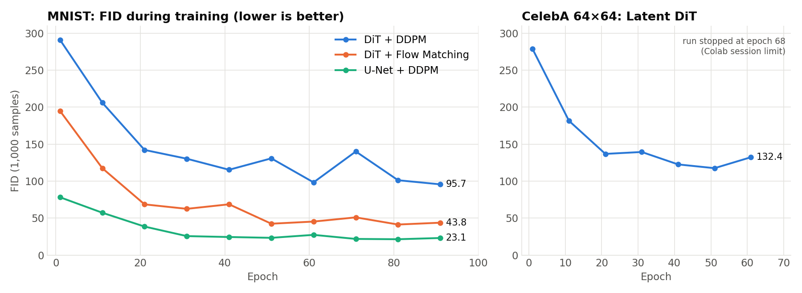
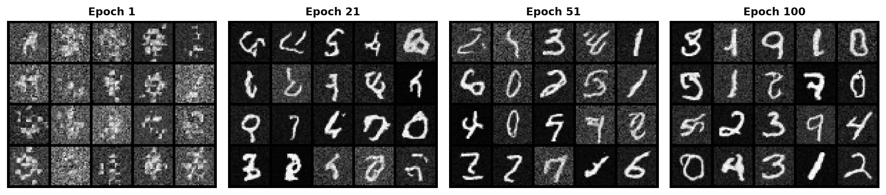
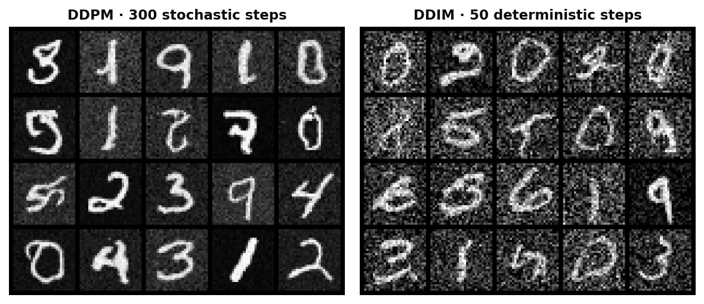
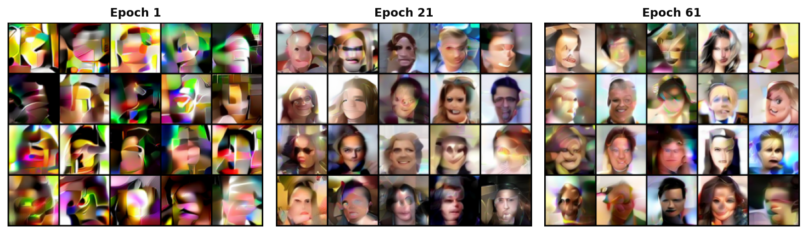

# Diffusion Transformers from Scratch

**A Diffusion Transformer (DiT) built in PyTorch, then used to compare five generative setups side by side: DDPM, DDIM, Flow Matching, a U-Net baseline and Latent Diffusion on CelebA faces.**



## The problem

Diffusion models generate images by learning to undo noise step by step. Modern systems such as Stable Diffusion 3 and Sora replace the classic convolutional U-Net with a **transformer that works on image patches** (Peebles & Xie, *Scalable Diffusion Models with Transformers*, 2023).

This project builds that transformer from the ground up and uses it to answer three practical questions:

1. **Architecture:** does a transformer (DiT) or a convolutional U-Net denoise better at small scale?
2. **Training objective:** how does classic noise prediction (DDPM) compare with velocity prediction (Flow Matching)?
3. **Sampling and scale:** can generation be made faster (DDIM) and moved from pixels to a compressed latent space (Latent Diffusion)?

## Results

All FID scores compare **1,000 generated images** with 1,000 real images (Inception-v3, 2048-d features). They were logged every 10 epochs during training. They are useful for comparing the models in this repo with each other, but not with published FIDs, which use 50k samples.

| Model | Denoiser | Objective | Sampler | Dataset | FID at last checkpoint | Best FID logged |
|---|---|---|---|---|---|---|
| DiT + DDPM | DiT (5 blocks, 256-d) | ε-prediction | 300 stochastic steps | MNIST 28×28 | 95.69 (ep. 91) | 95.69 (ep. 91) |
| DiT + Flow Matching | DiT (continuous-t embedder) | velocity *v = ε − x₀* | 100 Euler steps | MNIST 28×28 | 43.82 (ep. 91) | **41.34** (ep. 81) |
| U-Net + DDPM | Conv U-Net with skip connections | ε-prediction | 300 stochastic steps | MNIST 28×28 | 23.13 (ep. 91) | **21.46** (ep. 81) |
| DiT + DDIM | reuses the DiT-DDPM weights | — | 50 deterministic steps | MNIST 28×28 | not measured (qualitative only) | — |
| Latent DiT | DiT on SDXL-VAE latents (8×8×4) | ε-prediction | 300 stochastic steps | CelebA 64×64 | 132.36 (ep. 61) | 117.55 (ep. 51) |



**Takeaways**

- **Inductive bias beats attention at small scale.** On MNIST the U-Net reaches roughly 4× lower FID than the DiT with the same DDPM objective (23.1 vs 95.7). Convolutions already encode locality, while a transformer has to learn it from data. DiTs only pay off at larger scale.
- **Flow Matching roughly halves the DiT's FID** (43.8 vs 95.7) with the same architecture, epochs and optimizer. It also converges faster and needs only 100 deterministic Euler steps.
- **DDIM samples about 6× faster.** It reuses the trained DDPM weights with 50 deterministic steps instead of 300, at the cost of noisier digits (see below).
- **Latent diffusion makes faces affordable.** Running diffusion on 8×8×4 VAE latents instead of 64×64×3 pixels lets the same small DiT generate face-like images. This run was stopped at epoch 68 of 100 by the Colab session limit, while the loss was still falling.

<table>
<tr>
<td></td>
</tr>
<tr><td align="center"><em>DiT + DDPM samples during training: from noise to digits.</em></td></tr>
</table>

| DDPM vs DDIM (same weights) | Latent DiT on CelebA |
|---|---|
|  |  |

## Architecture

```
image (B,C,H,W) ─► Patchify (p×p) ─► Linear ─► + 2D sin-cos pos. emb.
                                                    │
timestep t ─► Embedding ─► c ──────────────┐        ▼
                                           ├──► DiT block × N
                                           │      ├─ LayerNorm → scale/shift(γ₁,β₁) → Multi-Head Self-Attention → gate α₁ → +residual
                                           │      └─ LayerNorm → scale/shift(γ₂,β₂) → Feed-Forward          → gate α₂ → +residual
                                           │
                                           └──► (γ₁,β₁,α₁,γ₂,β₂,α₂) = MLP(c)   ← adaLN-Zero
                                                    ▼
                         LayerNorm ─► Linear (zero-init) ─► Unpatchify ─► predicted noise ε̂ (or velocity v̂)
```

- **adaLN-Zero conditioning.** The timestep sets six per-channel modulation vectors for each block. The MLP that produces them is zero-initialized, so every block starts out as the identity function, which keeps early training stable. The unit tests check this property.
- **Multi-head self-attention** is written by hand: per-head Q/K/V projections, scaled dot-product attention, then concatenation and an output projection.
- **Patch size 4 on 28×28 inputs** gives 49 tokens. The model has hidden size 256, 8 heads, FFN size 1024 and 5 blocks.

## What I implemented

The course provided the scaffold: unit tests, notebook skeleton, hyperparameters, the 2D positional embedding and the continuous timestep embedder. I implemented:

- **`src/DiT.py`:** `Patchify`/`Unpatchify` (einops), `SelfAttention`, `MultiHeadSelfAttn`, `FeedForward`, `DiTBlock` with adaLN-Zero, and the full `DiT` forward pass. It passes all 10 unit tests.
- **DDPM training and sampling:** linear β schedule (1e-4 → 0.02, T = 300), the closed-form forward process *x_t = √ᾱ_t x₀ + √(1−ᾱ_t) ε*, the MSE loss on ε, the reverse sampling loop and FID tracking.
- **DDIM:** deterministic sampling on a 50-step sub-sequence, predicting x₀ at each step and re-noising with the predicted ε.
- **Flow Matching:** linear interpolation *x_t = (1−t)x₀ + tε*, a velocity target, continuous t ∈ [0, 1] and an Euler ODE sampler.
- **U-Net baseline:** conv encoder and decoder with skip connections, and timestep injection through fully-connected blocks.
- **Latent Diffusion:** a frozen SDXL VAE (`stabilityai/sdxl-vae`) as encoder and decoder, latents scaled by 0.13025, a custom CelebA `Dataset`, and the DiT trained on 4-channel latents.

## Repository structure

```
├── src/DiT.py                      # Diffusion Transformer (patchify, attention, adaLN-Zero blocks)
├── tests/test_dit.py               # 10 unit tests for every module
├── notebooks/diffusion_models.ipynb  # DDPM, DDIM, Flow Matching, U-Net and Latent Diffusion, with outputs
├── results/                        # figures used in this README + fid_log.json (raw FID values)
├── requirements.txt
└── LICENSE
```

## How to run

```bash
git clone https://github.com/PabloCarreras7/diffusion-transformers-from-scratch.git
cd diffusion-transformers-from-scratch
pip install -r requirements.txt

# unit tests for the transformer
PYTHONPATH=src python tests/test_dit.py

# experiments (a GPU is strongly recommended; Google Colab with a T4 works)
jupyter notebook notebooks/diffusion_models.ipynb
```

The 100-epoch DiT + DDPM run took about 2–3 hours on a Colab T4. Checkpoints are written to `checkpoints/`, which git ignores.

## Data

- **MNIST** downloads automatically through `torchvision.datasets.MNIST`.
- **CelebA** (aligned and cropped, 202,599 images) is only needed for the latent-diffusion section. Download `img_align_celeba.zip` from [Kaggle](https://www.kaggle.com/datasets/jessicali9530/celeba-dataset) or the [official site](https://mmlab.ie.cuhk.edu.hk/projects/CelebA.html) and place it at `data/img_align_celeba.zip`.
- The **SDXL VAE** weights download automatically from the Hugging Face Hub.

## What I learned

- Why zero-initializing the conditioning path (adaLN-Zero) matters: each residual block starts as the identity, so a deep conditional transformer trains stably from step one.
- That the "transformer vs CNN" question depends on scale. On a small dataset the U-Net's locality prior wins clearly, and DiTs need far more data and compute to catch up.
- How DDPM, DDIM and Flow Matching relate: the same trained network can be sampled stochastically or deterministically, and choosing to predict velocity instead of noise changes how fast training converges.
- Practical engineering for long runs on limited hardware: checkpointing to survive session limits, a cheaper 1k-sample FID for monitoring, and the latent-space trick to make 64×64 RGB generation affordable.

## Acknowledgements and transparency

Part of this work comes from **CS 444: Deep Learning for Computer Vision at the University of Illinois Urbana-Champaign (Spring 2026)**. The starter code, unit tests and assignment design are by the course staff. I used **Claude Code** as an AI assistant.

References: Ho et al., *DDPM* (2020) · Song et al., *DDIM* (2021) · Lipman et al., *Flow Matching* (2023) · Rombach et al., *Latent Diffusion* (2022) · Peebles & Xie, *DiT* (2023).

## License

[MIT](LICENSE)
